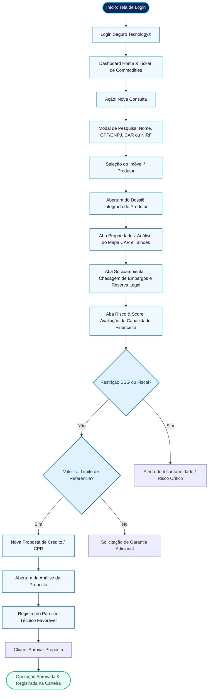
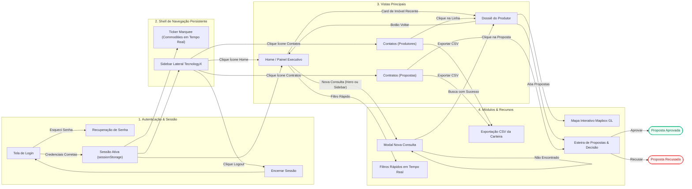

# TecnologyX Agro — Especificação de Casos de Uso e Mapa de Fluxos

Este documento detalha as personas, os casos de uso estruturados, as regras de negócio de crédito rural e os fluxos de navegação (caminho feliz e alternativos) da plataforma **TecnologyX Agro**.

---

## 1. Visão Geral e Personas

A plataforma **TecnologyX Agro** atua como uma esteira inteligente de originação, esteira de risco e concessão de crédito rural (CPR Financeira/Física, Custeio de Safra, Financiamento de Máquinas e Insumos), integrando dados geoespaciais (CAR/SIGEF), compliance socioambiental (IBAMA, ICMBio) e inteligência financeira.

### Personas do Sistema

| Persona | Perfil | Responsabilidades Principais |
| :--- | :--- | :--- |
| **Analista de Crédito Rural** | Risco & Mesa de Operações | Analisa propostas, avalia capacidade de amortização, confere limite de referência, revisa pareceres e aprova/recusa operações. |
| **Originador / Gerente Agro** | Comercial & Relacionamento | Localiza novos produtores, consulta matrículas/CAR, acompanha cotações de commodities para travar contratos e cadastra novas propostas. |
| **Auditor Socioambiental (ESG)** | Compliance & Governança | Verifica embargos em órgãos federais/estaduais, desmatamento (Prodes/Deter), terras indígenas e reservas legais do imóvel. |
| **Diretoria de Crédito / Gestor** | Estratégia & Portfólio | Monitora indicadores macro da carteira (volume total concedido, taxa de inadimplência esperada, score médio) e exporta relatórios. |

---

## 2. Diagrama do Caminho Feliz (Happy Path)

O caminho ideal descreve o fluxo sem fricção: o operador acessa o sistema, busca um produtor/imóvel, inspeciona o dossiê geoespacial e produtivo, submete uma proposta alinhada ao limite e o analista emite parecer favorável com aprovação imediata.

---

## 3. Mapa Geral de Navegação e Caminhos do Usuário

O diagrama a seguir mapeia todos os caminhos do usuário, cobrindo rotas principais, fluxos secundários, tratamento de exceções e ações em lote.

---

## 4. Especificação Detalhada dos Casos de Uso (UC)

### UC-01: Autenticação de Usuário e Inicialização de Sessão
- **Ator Principal:** Analista de Crédito / Originador.
- **Pré-condições:** Aplicação aberta no navegador em `http://localhost:3000`.
- **Gatilho:** Abertura da aplicação ou tentativa de acessar rota protegida sem sessão ativa.
- **Fluxo Principal:**
  1. O sistema exibe o formulário de login com a marca TecnologyX e slogan "Tecnologia · Dados · Automação".
  2. O operador preenche usuário/email e senha (com botão de alternância para exibir/ocultar senha).
  3. O operador clica em **Acessar Plataforma**.
  4. O botão exibe feedback visual (*spinner* "Acessando...").
  5. A sessão é validada, gravada em `sessionStorage.agro_auth = true` e o sistema redireciona o usuário para `#home` sem recarregar a página inteira.
  6. Uma notificação toast verde confirma o sucesso: *"Login realizado com sucesso! Bem-vindo à TecnologyX"*.
- **Fluxos Alternativos:**
  - **FA-01 (Esqueci minha senha):** O usuário clica em "Esqueci minha senha". O sistema abre modal informativo simulando o envio de link temporário de recuperação para `analista@verticeagro.com`.
  - **FA-02 (Logout manual):** O usuário clica no botão de encerramento na barra lateral. O token de sessão é expurgado e a tela de login volta a ser exibida.

---

### UC-02: Nova Consulta e Localização de Imóvel/Produtor
- **Ator Principal:** Analista de Crédito / Originador.
- **Pré-condições:** Usuário autenticado na plataforma.
- **Gatilho:** Clique no botão **Nova Consulta** (presente no Hero Card, na Sidebar ou no topo da Carteira).
- **Fluxo Principal:**
  1. O sistema abre o diálogo modal com foco automático no campo de pesquisa.
  2. O operador digita o termo de busca (Ex.: *"Fazenda Santa Cruz"*, *"00.000.000/0001-01"*, *"Sorriso"*, *"Horizonte"*).
  3. O operador pressiona `Enter` ou clica em **Consultar dados do imóvel →**.
  4. O sistema avalia propriedades e produtores:
     - Se encontrar correspondência de propriedade, abre o dossiê na aba de propriedades (`farms`) com o mapa posicionado no polígono da fazenda.
     - Se encontrar produtor por documento, nome ou cultura, abre o dossiê na aba de visão geral (`overview`).
  5. O modal é fechado e um toast confirma o registro localizado.
- **Fluxos Alternativos:**
  - **FA-01 (Seleção rápida por exemplos):** O operador clica diretamente em um dos cartões de exemplo exibidos abaixo do campo de busca. O sistema redireciona imediatamente para o respectivo dossiê.
  - **FA-02 (Registro não localizado):** O sistema exibe mensagem em vermelho no próprio formulário: *"Nenhum imóvel ou produtor encontrado para esta busca. Escolha um dos exemplos abaixo"*, mantendo o modal aberto para nova tentativa.
  - **FA-03 (Cancelamento):** O operador clica no botão de fechar (×), pressiona a tecla `Escape` ou clica fora da caixa de diálogo (backdrop). O modal fecha sem alterar o estado.

---

### UC-03: Análise Geoespacial, CAR e Sobreposições Fundiárias
- **Ator Principal:** Analista de Crédito / Auditor ESG.
- **Pré-condições:** Dossiê do produtor aberto na aba **Propriedades (CAR & Mapa)**.
- **Fluxo Principal:**
  1. O sistema renderiza o componente Mapbox GL com as camadas da propriedade selecionada:
     - Polígono de perímetro do imóvel (CAR).
     - Áreas de Preservação Permanente (APP) e Reserva Legal (RL).
     - Talhões produtivos agrícolas com coloração temática.
  2. O operador pode alternar a visualização entre satélite de alta resolução e mapa vetorial de relevo.
  3. O operador pode selecionar entre diferentes propriedades do produtor (ex.: *Fazenda 1*, *Fazenda 2*), atualizando o bounding box do mapa com animação suave de transição.
  4. O sistema exibe o resumo de conformidade: área total georreferenciada em hectares, status do CAR (Ativo/Pendente) e sobreposição territorial.
- **Fluxos Alternativos:**
  - **FA-01 (Alerta de Sobreposição):** Se houver sobreposição com área indígena ou parque ambiental, o indicador de risco na barra superior é elevado para o status *Risco Alto* e a proposta vinculada tem trava preventiva.

---

### UC-04: Avaliação de Score, Risco Financeiro e Limite de Crédito
- **Ator Principal:** Analista de Crédito.
- **Pré-condições:** Dossiê do produtor aberto na aba **Risco & Score**.
- **Fluxo Principal:**
  1. O sistema exibe o velocímetro/score de risco (0 a 100), categorizado em:
     - **80 – 100:** Risco Baixo (Aprovável em esteira expressa).
     - **60 – 79:** Risco Médio (Exige garantias acessórias ou mitigadores).
     - **0 – 59:** Risco Alto / Crítico (Requer comitê ou recusa).
  2. O analista confere a composição do limite de crédito de referência versus o faturamento anual declarado.
  3. O sistema expõe o histórico de safras passadas, índice de adimplência em CPRs anteriores e capacidade de pagamento estimada.

---

### UC-05: Criação e Submissão de Proposta de Crédito / CPR
- **Ator Principal:** Originador / Analista de Crédito.
- **Pré-condições:** Usuário autenticado, produtor selecionado.
- **Gatilho:** Clique no botão **Nova Proposta** no Dossiê ou na tela de Contratos.
- **Fluxo Principal:**
  1. O sistema abre o formulário de simulação de proposta.
  2. O operador define:
     - **Finalidade:** Custeio de Safra, CPR Financeira, Maquinário ou Insumos.
     - **Valor solicitado (R$):** Valor nominal da operação.
     - **Prazo:** 12, 18, 24 ou 36 meses.
  3. O sistema calcula e exibe em tempo real o teto de tolerância frente ao limite de crédito do produtor.
  4. O operador confirma o envio. A proposta entra na esteira com status *"Em análise"* e é inserida na lista de contratos.

---

### UC-06: Parecer Técnico e Decisão da Proposta
- **Ator Principal:** Analista de Crédito Sênior.
- **Pré-condições:** Proposta existente em status *"Em análise"*.
- **Gatilho:** Clique sobre o card ou linha da proposta.
- **Fluxo Principal:**
  1. O sistema abre o modal de decisão contendo:
     - ID da proposta e nome do produtor.
     - Valor solicitado, finalidade, prazo e limite de referência.
     - Campo obrigatório de texto: **Parecer do analista**.
  2. O analista preenche as justificativas técnicas e escolhe uma das ações:
     - **Aprovar Proposta:** Grava status *"Aprovada"*, registra data e emite confirmação toast.
     - **Salvar Parecer:** Mantém status *"Em análise"*, salvando o texto para complemento posterior.
     - **Recusar:** Grava status *"Recusada"*, exigindo justificativa clara no parecer.
  3. A persistência é atualizada imediatamente no estado local (`state.proposals`) e no `localStorage`.
- **Fluxos Alternativos:**
  - **FA-01 (Tentativa de aprovação sem parecer):** O sistema impede o fechamento e exibe alerta: *"Registre um parecer antes de concluir a análise"*.

---

### UC-07: Gestão da Carteira e Exportação de Relatórios CSV
- **Ator Principal:** Analista de Crédito / Gestor / Auditor.
- **Pré-condições:** Acesso à tela de **Contatos** ou **Contratos**.
- **Fluxo Principal:**
  1. O operador pesquisa ou filtra registros através do campo de busca textual em tempo real.
  2. O operador clica no botão **Exportar CSV**.
  3. O sistema compila os dados com delimitadores padronizados (ponto e vírgula), insere o cabeçalho UTF-8 BOM (`\uFEFF`) para compatibilidade nativa com Microsoft Excel e faz o download automático do arquivo:
     - `produtores-carteira.csv` (na tela de Contatos).
     - `propostas-contratos.csv` (na tela de Contratos).

---

## 5. Matriz de Decisão de Crédito e Regras de Negócio (RN)

| Código | Regra de Negócio | Descrição e Impacto |
| :--- | :--- | :--- |
| **RN-01** | **Trava de Limite de Crédito** | A soma de todas as propostas ativas de um produtor não pode ultrapassar o seu `Limite de Referência` sem aprovação de garantia real (alienação/hipoteca). |
| **RN-02** | **Conformidade Ambiental (Zero Desmate)** | Imóveis com sobreposição com embargos IBAMA ou desmatamento não autorizado têm o dossiê marcado com flag de risco crítico e aprovação bloqueada. |
| **RN-03** | **Validade Mínima do CAR** | Propriedades com CAR cancelado ou suspenso impedem a emissão de CPR sobre o imóvel correspondente. |
| **RN-04** | **Parecer Técnico Mandatório** | Nenhuma proposta pode ser aprovada ou recusada sem preenchimento prévio do campo textual de justificativa técnica do analista. |
| **RN-05** | **Persistência de Sessão Sem Flicker** | A navegação entre visões internas mantém o shell (menu lateral e ticker) montados, garantindo carregamento instantâneo sem telas em branco. |

---

## 6. Próximas Evoluções Sugeridas (Backlog para Discussão)

1. **Assinatura Eletrônica da CPR:** Integração com ICP-Brasil / DocuSign para formalização jurídica direta ao aprovar a proposta.
2. **Alertas de Clima em Tempo Real:** Inclusão de dados de precipitação acumulada e risco de seca nas abas do dossiê.
3. **Simulador de Barter:** Conversão automática do valor do financiamento em sacas de soja ou milho com base nas cotações do ticker ativo.
4. **Exportação de Dossiê Executivo em PDF:** Geração de laudo pericial pronto para comitê de crédito com mapa, fotos de satélite e parecer.

